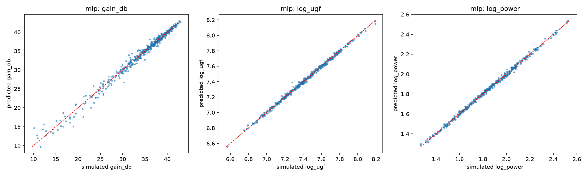
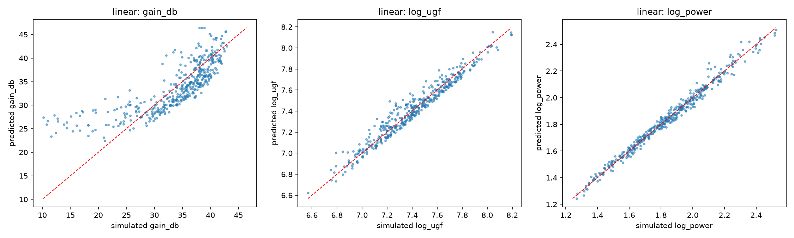
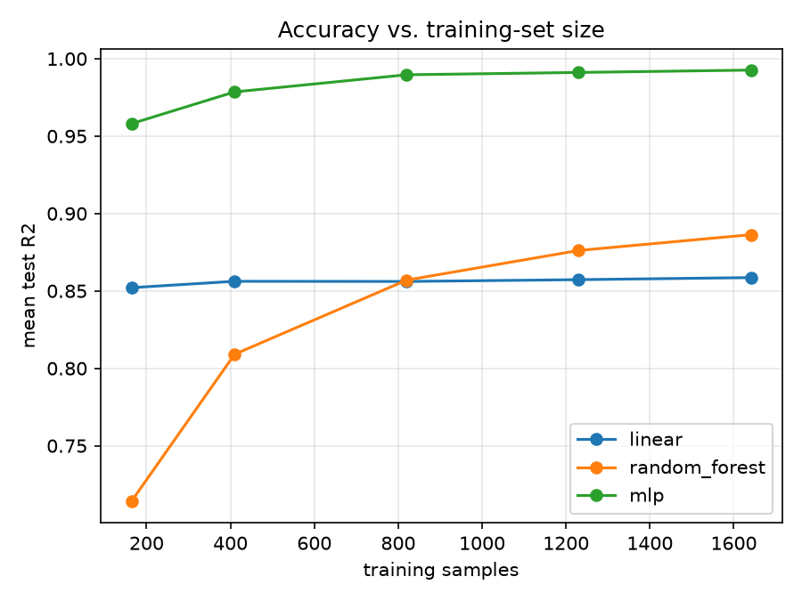

# ML-Guided Analog Circuit Sizing

Train a machine-learning surrogate model to predict the performance of an analog circuit (gain, bandwidth, power) from its transistor sizing, then use it with an optimizer to find designs that meet a target specification. Results are checked against a real SPICE simulator.

> **Status:** in progress. The simulation toolchain, circuit characterization, dataset generation, and surrogate-model training are done. The optimizer, demo app, and Cadence cross-check are next.

## Why this project

Sizing an analog circuit is usually trial and error: pick transistor sizes, simulate, look at the result, adjust, repeat. A surrogate model that has learned the sizing-to-performance relationship can predict results instantly, so an optimizer can search thousands of designs in seconds and only the best candidate needs a real simulation.

## Approach

1. **Generate data.** Simulate a 5-transistor OTA in ngspice across thousands of random sizings and record gain, bandwidth, and power.
2. **Train models.** Compare linear regression, a random forest, and a small neural network at predicting performance from sizing.
3. **Optimize.** Use the most accurate model inside a genetic algorithm or Bayesian optimizer to hit a target spec.
4. **Verify.** Run the winning design in the real simulator and report the gap between predicted and simulated values.
5. **Cross-check.** Reproduce the design in Cadence Virtuoso/Spectre.

## Tools

- **Simulation:** ngspice, Xschem
- **Process models:** SkyWater SKY130 open-source PDK
- **Environment:** [IIC-OSIC-TOOLS](https://github.com/iic-jku/iic-osic-tools) running in Docker
- **Data and ML:** Python, pandas, scikit-learn, matplotlib
- **Planned:** an optimizer (Optuna or pymoo) and a Streamlit demo app

## Repository contents

| File | What it does |
|---|---|
| `nmos_iv.cir` | NMOS drain current vs. drain voltage for several gate voltages |
| `nmos_gm.cir` | NMOS drain current and transconductance (gm) vs. gate voltage |
| `cs_amp.cir` | Common-source amplifier: operating point, AC gain, bandwidth, unity-gain frequency |
| `ota5t.cir` | 5-transistor OTA: operating point, AC gain, bandwidth, unity-gain frequency, power |
| `gen_dataset.py` | Samples random sizings, runs ngspice in batch mode, parses results, filters bad circuits, writes a CSV |
| `explore.py` | Summary statistics, headroom checks, and input/output correlations for the dataset |
| `train_models.py` | Trains and compares the three models, saves metrics, plots, and a learning curve |
| `dataset.csv` | 3000 simulated sizings (2187 valid) |
| `results_models.csv` | Model comparison table |
| `figures/` | Plots |

## How to run

1. Start Docker Desktop, then start the IIC-OSIC-TOOLS container (for example with `start_vnc.bat` from its repo) and open `http://localhost/` in a browser.
2. Put the project files in the shared designs folder (`/foss/designs/` in the container).
3. In the container terminal:

```
cd /foss/designs/<project folder>
ngspice ota5t.cir                                  # one circuit by hand
python3 gen_dataset.py -n 3000 --out dataset.csv   # generate the dataset
python3 explore.py                                 # inspect it
pip install --user scikit-learn matplotlib
python3 train_models.py --learning-curve           # train and compare models
```

If the SKY130 library path in the `.lib` lines differs on your setup, update it to match your install.

## Results

### 1. NMOS characteristics (SKY130, W = 1, L = 0.5)


- Threshold voltage is about 0.6 V, where the drain current starts to rise.
- Doubling W roughly doubled the drain current and gm. Increasing L reduced the current.
- The device does not follow the ideal square law: Id becomes nearly linear at high Vgs and gm levels off near 270 µA/V, which is typical of short-channel devices.

### 2. Common-source amplifier (W = 2, L = 0.5, CL = 1 pF, VDD = 1.8 V)


| Gate bias | RD | Supply current | v(out) | Power | DC gain | -3 dB bandwidth | Unity-gain freq |
|---|---|---|---|---|---|---|---|
| 0.7 V | 10 kΩ | 4.7 µA | 1.753 V | ≈ 8.5 µW | ≈ -2.5 dB | not measured | not measured |
| 0.8 V | 10 kΩ | 16.9 µA | 1.631 V | ≈ 30.4 µW | 4.59 dB | 16.0 MHz | 22.0 MHz |
| 0.8 V | 20 kΩ | 16.7 µA | 1.466 V | ≈ 30.1 µW | 10.44 dB | 8.11 MHz | 25.8 MHz |

The gain at 0.7 V is read from the plot. The other values come from ngspice `meas` commands.

### 3. 5-transistor OTA (VDD = 1.8 V, Ib = 10 µA, CL = 1 pF)

```
                    VDD
              ┌──────┴──────┐
         M3 ──┤             ├── M4        PMOS mirror load (gates tied to d1)
              │ d1          │ out ── CL
         M1 ──┤             ├── M2        NMOS pair (inp on M1, inn on M2)
              └──────┬──────┘
                   tail
                     │
                 M5 (gate = nb)           NMOS tail source
                     │
                    GND

  Bias: Ib flows into diode-connected M6, which sets nb; M5 mirrors it.
```

Baseline sizing: M1-M4 W = 4, L = 0.5; M5 W = 4, L = 1; M6 W = 2, L = 1. Both inputs at 1.0 V DC.


| Run | M1/M2 L | M3/M4 L | v(out) | v(tail) | Supply current | Power | DC gain | -3 dB bandwidth | Unity-gain freq |
|---|---|---|---|---|---|---|---|---|---|
| Baseline | 0.5 | 0.5 | 0.666 V | 0.247 V | 28.98 µA | ≈ 52.2 µW | 35.58 dB | 393 kHz | 23.7 MHz |
| Longer L everywhere | 1 | 1 | 0.551 V | 0.232 V | 28.84 µA | ≈ 51.9 µW | 35.57 dB | 316 kHz | 19.0 MHz |
| Longer L on load only | 0.5 | 1 | 0.550 V | 0.245 V | 28.97 µA | ≈ 52.1 µW | 35.34 dB | 399 kHz | 23.3 MHz |

Derived from the baseline: gm of the input pair ≈ 2π · UGF · CL ≈ 149 µS, and output resistance ≈ gain / gm ≈ 400 kΩ (compared with 20 kΩ for the resistor load in the common-source amplifier).

### 4. Dataset

**Design variables** (sampled log-uniformly and independently; M1 = M2 and M3 = M4 to keep the pair and the mirror matched, and M6 uses the same L as M5):

| Variable | Meaning | Range |
|---|---|---|
| WP, LP | input pair width and length | 1-40 µm, 0.5-2 µm |
| WL, LL | PMOS load width and length | 1-40 µm, 0.5-2 µm |
| WT, LT | tail source M5 width and length (M6: W = 2) | 2-16 µm, 0.5-2 µm |
| IB | reference current | 5-30 µA |

**Generation.** `gen_dataset.py` draws 3000 random sizings (fixed seed), simulates each in ngspice batch mode with parallel workers, parses the printed values, and flags each circuit as valid or rejected.

| Stage | Rows |
|---|---|
| Simulated | 3000 |
| Valid after the generation filters | 2187 (73%) |
| After the training filter (at least 0.1 V headroom on M2, at least 10 dB gain) | 2052 |

**Rejections (813):** 307 had the tail source in triode (`v(tail)` below 0.1 V). The other 506 had a failed gain measurement (447 missing the unity-gain frequency, 59 missing both it and f3db). A hand simulation of one of those sizings showed a DC gain of -26 dB with the output pulled down to 0.16 V, so at least that case is a circuit that attenuates instead of amplifying, and the measurement fails because the gain never crosses 0 dB. The rest of the group was not checked individually.

**Output ranges (valid rows):**

| Output | Minimum | Median | Maximum |
|---|---|---|---|
| DC gain | 0.4 dB | 35.3 dB | 43.4 dB |
| Unity-gain frequency | 2.3 MHz | 23.3 MHz | 186 MHz |
| -3 dB bandwidth | 44 kHz | 472 kHz | 44 MHz |
| Power | 18 µW | 68 µW | 416 µW |

**Input/output correlations** (Pearson correlation of the raw sizing variables with the outputs, valid rows; UGF and power on a log scale):

| Input | Gain (dB) | log UGF | log power |
|---|---|---|---|
| WP | 0.08 | 0.48 | 0.14 |
| LP | 0.02 | -0.15 | -0.01 |
| WL | 0.41 | 0.23 | 0.15 |
| LL | -0.15 | -0.14 | -0.07 |
| WT | -0.34 | 0.53 | 0.63 |
| LT | 0.01 | -0.04 | -0.01 |
| IB | -0.18 | 0.36 | 0.67 |

Power follows the supply current (about 1.8 V × Ib × (1 + WT/2)), so it depends mainly on IB and WT. UGF rises with the pair width and the current (more gm). Gain rises with the load width and falls with more current or a longer load, which matches the headroom and output-resistance effects seen in the hand experiments.

### 5. Surrogate models

**Setup.** Inputs are the 7 sizing variables on a log scale. Outputs are DC gain (dB), log10 of the unity-gain frequency, and log10 of power. The 2052 filtered rows are split 80/20 (1641 train, 411 test, one random split). The bandwidth is not predicted directly because f3db = UGF / gain.

**Test results** (R² on unseen circuits, and typical error: dB for gain, percent for UGF and power):

| Model | Gain R² | Gain error | UGF R² | UGF error | Power R² | Power error |
|---|---|---|---|---|---|---|
| Linear regression | 0.642 | 3.0 dB | 0.949 | 12.4% | 0.985 | 5.4% |
| Random forest | 0.812 | 1.9 dB | 0.893 | 17.5% | 0.955 | 9.8% |
| **Neural network (MLP)** | **0.985** | **0.57 dB** | **0.997** | **3.0%** | **0.997** | **2.5%** |

**Overfitting check** (train R² vs. test R² on gain): linear 0.621 vs. 0.642, random forest 0.974 vs. 0.812, MLP 0.994 vs. 0.985. The random forest has the largest gap.





**Learning curve** (mean test R² over the three outputs):

| Training rows | Linear | Random forest | MLP |
|---|---|---|---|
| 164 | 0.852 | 0.714 | 0.958 |
| 410 | 0.856 | 0.809 | 0.979 |
| 820 | 0.856 | 0.857 | 0.990 |
| 1230 | 0.857 | 0.876 | 0.991 |
| 1641 | 0.859 | 0.886 | 0.993 |



## What I learned

**Single transistor**
- **Current scales with W/L.** Doubling W doubled the drain current and gm; doubling L reduced the current.
- **Real devices deviate from the square law.** Id becomes nearly linear at high Vgs and gm flattens, which is typical of short-channel transistors, so hand formulas are only a rough guide.
- **Current flattens in saturation because the channel pinches off.** Once Vds reaches about Vgs minus Vth, extra drain voltage drops across a small pinched-off region instead of adding current, so the gate sets the current.
- **Read the axis numbers, not the plot shape.** ngspice autoscales its axes, so two plots can look identical while their values differ by 2x.

**Common-source amplifier**
- **Gate bias sets the current.** Changing RD from 10k to 20k left the supply current at about 16.7 to 16.9 µA.
- **A weakly biased amplifier can have gain below 1.** At a 0.7 V gate bias, only about 0.1 V above threshold, gm was small and the circuit attenuated the signal.
- **Gain and bandwidth trade off.** Doubling RD added about 6 dB of gain and halved the bandwidth. Gain times bandwidth stayed near 27 MHz in both runs, so getting more of both needs more gm (more current and power) or less load capacitance.

**5-transistor OTA**
- **Mirror ratio scales the current.** With M5 twice as wide as M6 and Ib = 10 µA, the ideal tail current is 20 µA, split into 10 µA per side. I first answered this wrongly (5 µA), by treating the mirror as 1:1.
- **Mirrors are not exact.** The measured supply current was 28.98 µA instead of the ideal 30 µA, so the tail current is about 19 µA. M6 sits at Vds of about 0.78 V while M5 sits at about 0.25 V, and a lower drain voltage gives slightly less current.
- **The load mirror should be 1:1.** If M4 were wider than M3 it would try to source more current than M2 can sink, pushing the output node toward VDD and collapsing the gain.
- **The mirror load gives high gain.** Gain ≈ gm1 · (ro2 ∥ ro4). The OTA reached about 60x (35.6 dB) with a 1 pF load, because the output resistance (about 400 kΩ) is far higher than a practical resistor.
- **Gain times bandwidth is consistent.** 60 × 393 kHz ≈ 23.7 MHz, matching the measured unity-gain frequency, so UGF ≈ gm / (2π · CL) describes this circuit well.
- **My prediction about longer L failed.** I predicted that making M1-M4 longer would raise both gain and UGF. In simulation the gain stayed at 35.6 dB and the UGF fell 20% (23.7 to 19.0 MHz). Halving W/L lowered gm, but the output resistance rose only about 1.25x instead of 2x.
- **Lengthening the load alone did not raise gain either.** Gain was 35.34 dB and UGF was unchanged. A likely explanation, not yet tested, is that the output resistance is dominated by the smaller of ro2 and ro4, and the longer PMOS load lowered `v(out)` from 0.67 V to 0.55 V, leaving M2 only about 0.3 V of drain-source voltage and degrading its output resistance.

**Dataset**
- **Check what a rejection means.** The "missing unity-gain frequency" label was vague. Hand-simulating one rejected sizing showed it was a non-amplifying circuit (-26 dB), so the rejection was right, but I would not have known without looking.
- **Random sizing exposes interactions.** Varying all variables together reproduced the effects seen in the hand experiments: a wider load raised gain (more headroom), a longer load lowered it, and more current lowered gain while raising UGF and power.
- **Keep the CSV complete and filter at training time.** Marginal designs (little headroom, almost no gain) are removed in the training script, so the filter thresholds are visible and easy to change.

**Machine learning**
- **The right model depends on the structure of the problem.** UGF and power are close to power laws, which are straight lines on log axes, so plain linear regression (R² 0.949 and 0.985) beat the random forest (0.893 and 0.955) on those outputs.
- **Gain needs a model that handles interactions.** Linear regression only reached R² 0.64 on gain. The MLP reached 0.985, with a typical error of 0.57 dB.
- **A random forest approximates smooth functions with flat steps.** It fitted its training data almost perfectly (gain R² 0.974) but did worse on unseen circuits (0.812).
- **The MLP overfit very little** (train and test R² within about 0.01), probably because the simulator is deterministic and the relationships are smooth.
- **More data has diminishing returns.** The MLP's mean R² went from 0.990 at 820 training rows to 0.993 at 1641, so about 800 training rows (roughly 1,200 simulations at the 68% usable rate) was nearly enough. Linear regression stayed near 0.86 regardless of data size, which shows its limit is the model, not the data.
- **My predictions about the models were partly wrong.** I guessed the random forest would be best on gain, but the MLP was best by a wide margin.

## Limitations

- Results come from a single random train/test split and one seed. Repeating with several seeds or cross-validation would give error bars.
- The test circuits come from the same sampled ranges as the training data, so the accuracy applies inside those ranges, not outside them.
- Marginal designs were filtered out, so the model is only meant for working amplifiers.
- One circuit topology, one process corner (typical, 27 °C), fixed supply, load capacitance, and input common-mode voltage, and no mismatch or noise.
- The model predicts the ngspice result, not measured silicon.

## Roadmap

- [x] Set up simulation toolchain (Docker, ngspice, Xschem, SKY130)
- [x] NMOS I-V curves and transconductance (gm)
- [x] Common-source amplifier (gain, bandwidth, power)
- [x] 5-transistor OTA (baseline and length experiments)
- [x] Automated dataset generation from Python
- [x] ML models and comparison (linear, random forest, MLP)
- [ ] Multi-seed or cross-validated evaluation
- [ ] Optimization: search for sizings that meet a spec using the MLP
- [ ] Verify the optimizer's designs in ngspice and compare against brute-force search
- [ ] Interactive demo app
- [ ] Cadence Virtuoso/Spectre cross-check
- [ ] Test the headroom hypothesis (widen the PMOS load and check whether `v(out)` and gain recover)
- [ ] Final write-up